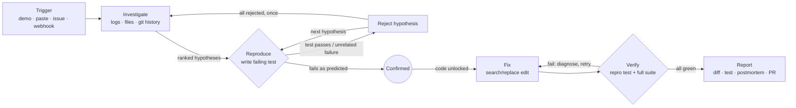

# Fixsi

**It doesn't guess. It proves.**

Fixsi is an autonomous debugging agent. Something breaks: an error, a stack trace, a bug report, or an error webhook from your app. Fixsi investigates like a senior engineer, then **proves the root cause by writing a test that reproduces the bug**. It fixes the code until that test passes without breaking any existing test, and opens a pull request with a postmortem.

> **The rule:** Fixsi never edits application code until a failing reproduction test has confirmed a hypothesis. That test is the proof, and it is the bar the fix must clear.

Built for the **Nebius × NVIDIA Global AI Hackathon** (track: Coding and Agentic Engineering). All inference runs on **NVIDIA Nemotron** models through **Nebius Token Factory**.

| | |
|---|---|
| 🌐 Live demo | `TODO: https://your-fixsi.vercel.app` |
| 🎬 Video | `TODO: link` |
| 🖼️ Screenshots | `TODO: docs/screenshot-desktop.png`, `docs/screenshot-phone.png` |
| 🎞️ GIF | `TODO: docs/fixsi-bug4.gif` (bug #4: a hypothesis is rejected, then the real one is confirmed) |

---

## How it works

Every investigation run passes through six stages, streamed live to the UI over Server-Sent Events:

1. **Trigger:** a built-in demo incident, a pasted error/stack trace (+ logs), a GitHub issue URL, or an HMAC-signed webhook from the app when it throws.
2. **Investigate:** condense long logs (Nano), list the repo and pick the relevant files (Nano), read them, inspect recent git commits touching those files, then generate 2–4 **ranked hypotheses** with evidence for and against (Ultra).
3. **Reproduce:** for the top untested hypothesis, write a `node:test` test that should **fail** if the hypothesis is right (Super), and run it in the sandbox.
   - Fails for the predicted reason → **confirmed** (Nano classifies the failure; Ultra adjudicates when it's ambiguous).
   - Passes, or fails for an unrelated reason (import/syntax/fixture) → the test is repaired once if it's a test bug, otherwise the hypothesis is **rejected**. If every hypothesis is rejected, Fixsi goes back to Investigate once with the new evidence.
4. **Fix:** propose a minimal search/replace edit (Super), apply it, and run the reproduction test plus the full suite. On failure, Ultra diagnoses why and the next attempt gets that feedback (up to `MAX_FIX_ATTEMPTS`).
5. **Verify:** accept only if the reproduction test passes **and** every pre-existing test still passes. Patches that touch pre-existing tests are rejected outright, and test files are hash-checked before acceptance.
6. **Report:** a unified diff, the new test, and a postmortem (Summary · Impact · Root cause · Evidence · Fix · How it was verified · Prevention). Fixsi opens a PR on `fixsi/<run-id>` when GitHub is configured; otherwise the UI offers a `.patch` download.



The reproduce-first rule is enforced in code, not just in prompts. `Workspace.applyEdits` throws `EditsLockedError` until the orchestrator unlocks it after a confirmation, and `backend/tests/orchestrator.test.js` asserts that no `patch_proposed`/`patch_applied` event ever precedes `hypothesis_confirmed`.

## How Fixsi uses NVIDIA Nemotron

`backend/src/llm/router.js` holds a single routing table (`TASK_TIERS`). Each task goes to the smallest Nemotron model that can do it well:

| Tier | Env var | Tasks | Why |
|---|---|---|---|
| **Nano** | `NEMOTRON_NANO_MODEL` | `label_incident`, `pick_files`, `condense_logs`, `summarize_file`, `classify_failure` | High-volume, low-stakes calls that need speed |
| **Super** | `NEMOTRON_SUPER_MODEL` | `write_repro_test`, `repair_test`, `write_fix`, `interpret_test_output`, `pr_title` | Code generation and reading test output: strong coding at a reasonable cost |
| **Ultra** | `NEMOTRON_ULTRA_MODEL` | `generate_hypotheses`, `judge_reproduction`, `diagnose_fix_failure`, `postmortem` | Deep reasoning where a wrong answer is expensive, such as a wrong root cause or a wrong confirmation |

What the router does:
- **Structured outputs:** every call asks for JSON matching a zod schema (`llm/schemas.js`). Parsing strips `<think>…</think>` blocks and code fences and extracts the first JSON object. On a validation error it retries once with the error included. It does not rely on JSON mode or tool calling; set `LLM_USE_JSON_MODE=true` to try `response_format` first, with automatic fallback.
- **Resilience:** exponential backoff on 429/5xx/timeouts (max 3 tries). If a tier still fails, the call **falls back one tier** (Ultra → Super → Nano) and is marked `fallback=true`.
- **Budget:** a per-run token budget (`MAX_TOKENS_PER_RUN`) stops the run gracefully with a clear `budget_exceeded` error.
- **Telemetry:** every call records run, stage, task, tier, model, prompt/completion tokens, latency, success and fallback. It is stored in SQLite and emitted as a `model_call` SSE event. The run page shows a live per-tier meter, and **`/how-it-works`** charts usage across all runs from `/api/stats`.

## Built on Nebius

- **Nebius Token Factory:** the only inference provider. The OpenAI-compatible API meant a ~50-line `fetch` client (`llm/client.js`) was enough, so routing between three Nemotron sizes became a lookup table rather than three integrations. The base URL and all model IDs are set through env vars (`NEBIUS_BASE_URL`, `NEMOTRON_*_MODEL`), so you can switch models without code changes. Run `npm run list:models` (in `backend/`) to see the Nemotron IDs on your account.
- **Nebius Serverless Jobs (sandbox mode):** with `SANDBOX_MODE=nebius_jobs`, each test run is submitted as a Serverless Job through the `nebius` CLI (`nebius ai job create`). The workspace is packed into a tar.gz and attached with `--inject-file`, a `node:22-slim` container runs `node --test` with Fixsi's JSON reporter, and Fixsi polls `nebius ai job get` and reads the report back from `nebius ai job logs`. If the CLI or project isn't configured, or a job fails or times out, Fixsi logs a warning and **falls back to the local sandbox automatically**.
  - *Trade-off:* a job gives each test run its own VM, which is strong isolation for untrusted code, but job startup adds tens of seconds to minutes per run. A typical investigation does 5–8 test runs, so local mode is faster for demos and Jobs is the safer choice for running arbitrary repos. Injected files are limited to 64 KiB, which fits demo-shop; larger repos would mount a bucket with `--volume`.
- **Nebius Serverless Endpoints (deployment option):** the backend is a single stateless container (`backend/Dockerfile`, with SQLite on a volume), so it can be deployed as an endpoint with `nebius ai endpoint create --image <your-registry>/fixsi-backend --container-port 8000`.

## Quick start

**Prerequisites:** Docker with Compose v2.24+ (or Node 22.5+ and git for the non-Docker path).

```bash
cp .env.example .env
# Fill in NEBIUS_API_KEY (or leave it empty for Replay mode) and set a long random WEBHOOK_SECRET
docker compose up --build
```

Open http://localhost:3000 (API at http://localhost:8000/api/health). In Docker, nginx serves the React app and proxies `/api` to the backend.

**Without Docker:**

```bash
# backend (Express)
cd backend
npm install
npm run dev              # http://localhost:8000; reads ../.env; builds the demo-shop repo on first start

# frontend (Vite + React), second terminal
cd frontend
npm install
npm run dev              # http://localhost:5173; /api is proxied to the backend
```

> The backend stores runs with Node's built-in `node:sqlite`, so the npm scripts pass `--experimental-sqlite`. Use the scripts (or that flag) rather than plain `node src/server.js`.

**Token Factory keys and models:** create an API key at [tokenfactory.nebius.com](https://tokenfactory.nebius.com) and put it in `NEBIUS_API_KEY`. The defaults in `.env.example` are Nemotron Nano / Super / Ultra IDs. Verify them with `npm run list:models` (in `backend/`), which also warns if a configured ID isn't in your catalog.

**Replay mode:** when `NEBIUS_API_KEY` is empty or `REPLAY_MODE=true`, the four demo incidents play back recorded event streams (`backend/src/replay/*.json`) with realistic timing, labelled **Replay** in the UI. The demo keeps working for judges even if credits run out. Pasted errors and GitHub issues always require live mode. To (re)record with live models:

```bash
cd backend
npm run record:replays                  # all four, live Nemotron
npm run record:replays -- --scripted    # no key: scripted model replies (UI shows "Replay (scripted)")
```

> The recordings currently committed were made with `--scripted`. The workspace, git history, sandboxed test runs, patches and diffs in them are real, but the model replies are pre-written and the token counts are estimates. Re-record with a live key before judging.

## Running the demo

`backend/demo-shop/` is a small storefront package (plain ES modules, money in integer cents) (products, inventory, users, cart, discount codes, pricing, orders) with 30 passing tests and 13 commits of history. It contains four planted bugs in paths the tests don't cover:

| # | Incident | What Fixsi should do |
|---|---|---|
| 1 | **500 at checkout for customers without a saved address:** `TypeError: Cannot read properties of undefined (reading 'country')` | Confirm that `checkout()` reads `user.addresses[user.defaultLabel]` without checking it exists. The first fix (optional chaining only) fails verification with a `PricingError`; Ultra diagnoses it and attempt 2 throws the documented `CheckoutError`. |
| 2 | **Bulk discount not applied at exactly 10 units:** no exception, only wrong numbers in the logs | Boundary test at 9/10 units → `>` becomes `>=` in `promotions.js`. |
| 3 | **Totals off by one cent since the last deploy** | `git log` shows *"refactor: round prices consistently"*; `git show` reveals `Math.round(Number((amount / 100).toFixed(2)) * 100)`. A half-cent test fails (0.825 → 0.82) → round the cents directly with `Math.round`. |
| 4 | **InventoryError when cancelling after "Buy again"** (the misleading one) | The trace points at `inventory.js`, so H1 "release() mis-tracks reserved stock" is tested first. Its test **passes → rejected**. H2 "`Cart.restore()` aliases the order's line items" fails as predicted → **confirmed**. Fix: copy items in `cart.js`. |

**Webhook auto-trigger:** each demo card has a **Break it** button. It runs the bug for real against demo-shop (`POST /api/demo-shop/break/{bug}`), captures the traceback and fires an HMAC-signed `POST /api/webhooks/error`, which starts a run. Your own app can do the same:

```bash
body='{"error":"TypeError: boom","stack_trace":"TypeError: boom\n    at checkout (shop/orders.js:54:45)","logs":"..."}'
sig="sha256=$(printf '%s' "$body" | openssl dgst -sha256 -hmac "$WEBHOOK_SECRET" | cut -d' ' -f2)"
curl -X POST localhost:8000/api/webhooks/error -H "X-Fixsi-Signature: $sig" -H 'Content-Type: application/json' -d "$body"
```

**GitHub PRs:** publish demo-shop with its history as a public repo, then fill in the `GITHUB_*` variables:

```bash
backend/scripts/publish-demo-shop.sh <your-github-user>          # uses `gh` if available; else create an empty repo first
```

Use a **fine-grained token** with *Contents* and *Pull requests* read/write on that repo only. With GitHub configured, successful runs open `fixsi/<run-id>` PRs titled `fix: <root cause>`, with the postmortem as the body and a "Generated by Fixsi" footer listing the Nemotron models used. You can also paste issue URLs from that repo. Without GitHub, the UI shows **Download .patch** and `/api/health` reports `github.configured: false`.

## Deploying

| Piece | Where | Env vars |
|---|---|---|
| Backend container (`backend/Dockerfile`, build context = `backend/`) | Render / Railway / Fly.io / **Nebius Serverless Endpoints** | everything in `.env.example`; set `CORS_ALLOWED_ORIGINS` to the frontend URL; mount a volume at `/app/data` to keep history |
| Frontend (`frontend/`, a static Vite build) | Vercel / Netlify / any static host (root directory `frontend`, build `npm run build`, output `dist`, SPA fallback to `index.html`), or `frontend/Dockerfile` (nginx) | `VITE_API_BASE_URL` = backend URL (inlined at **build** time); leave empty when nginx proxies `/api` |

Notes:
- Behind a proxy, the per-IP rate limit uses the first `X-Forwarded-For` hop. Keep `RATE_LIMIT_RUNS_PER_HOUR` and `MAX_CONCURRENT_RUNS` low on a public demo; replays don't count against them.
- **Free tiers sleep.** Render and Railway free instances spin down when idle, and the first request can take 30–60 s. Before judging, open `/api/health` and run one replay to warm the container. The UI shows "backend may be waking up" if a request fails.
- SSE needs proxies not to buffer; the backend sends `X-Accel-Buffering: no` and a heartbeat every 15 s.

## Architecture

```
fixsi/
├── backend/                 Node.js + Express (plain JavaScript, ES modules)
│   ├── src/
│   │   ├── server.js        entry point
│   │   ├── app.js           Express routes, SSE, webhooks, demo-shop "Break it"
│   │   ├── config.js        settings from env (names match .env.example)
│   │   ├── llm/             router.js (tiers, retries, fallback, budget, telemetry) · client.js · prompts.js · schemas.js (zod) · fake.js
│   │   ├── agent/           orchestrator.js (6-stage state machine) · tools.js · patcher.js · events.js · runs.js · incident.js
│   │   ├── sandbox/         base.js · local.js · nebiusJobs.js · reporter.mjs (node:test JSON reporter)
│   │   ├── integrations/    github.js (issues, branch/commit/PR)
│   │   ├── storage/db.js    node:sqlite: runs, events, model_calls
│   │   ├── replay/          recordings (*.json), player, scripted model replies
│   │   └── security.js      rate limiter, HMAC verification
│   ├── demo-shop/           victim app (JS), incidents/, setup-history.js (builds the git history)
│   ├── scripts/             record-replays.js · list-models.js · publish-demo-shop.sh
│   └── tests/               node:test suite
└── frontend/                Vite + React (JSX) + React Router + Tailwind
    └── src/                 pages/ (/, /runs, /runs/:id, /how-it-works) · components/ · lib/
```

**Event flow:** `POST /api/runs` → `RunManager` starts a background task (cancellable via an `AbortController`) → `Orchestrator` publishes typed events (`run_started`, `stage_changed`, `hypothesis_*`, `test_*`, `patch_*`, `model_call`, `report_ready`, `pr_opened`, `run_completed`, `error`) on the `EventBus` → each event is persisted to SQLite and fanned out to subscribers → `GET /api/runs/{id}/events` sends all past events, then live ones, with SSE `id:`s and 15 s heartbeats. Refreshes and late joins replay the history; the browser resumes with `Last-Event-ID` and the client de-duplicates by id.

**Sandbox security model:**
- Each run works on its own copy of the target repo in `WORKSPACES_DIR/<run-id>/`. Copies older than 24 h are removed at startup.
- Every agent path is resolved and checked to stay inside the workspace (no `..`, absolute paths, symlink escapes or `.git`). New tests can only be written under `tests/fixsi/` (as `*.test.js`).
- `node --test` runs in a subprocess with a **clean environment** (only `PATH`, `LANG` and a fake `HOME`, plus the system variables Windows needs), so API keys and tokens are never visible to code under test (this is tested). The working directory is locked to the workspace, the heap is capped, and the whole process tree is killed on timeout.
- Optional: Nebius Serverless Jobs runs each test in its own VM.
- Secrets are never logged. Webhook signatures are compared in constant time and never echoed. CORS is restricted to `CORS_ALLOWED_ORIGINS`. Pasted input is capped at 50 KB, and issue URLs must belong to the configured repo.

## Testing

```bash
cd backend && npm test                          # 68 tests, no API key needed
cd frontend && npm run lint && npm run build
cd backend/demo-shop && npm test                # the victim app's own suite (30 tests, all pass on the buggy code)
```

The backend suite covers router parsing, retries and fallback against a fake client. It also covers the patcher (exact match, ambiguity, protected tests, path traversal, symlink escape), the sandbox (pass/fail/load-error parsing, timeout kill, env scrubbing), webhook HMAC, rate limiting, replay and SSE, and GitHub PRs against a mocked API. On top of that are **end-to-end orchestrator runs with a scripted fake LLM** and the real local sandbox against demo-shop for all four bugs, including bug #4's reject → confirm → fix → verify → report path.

## Feedback on Nebius Token Factory, AI Cloud and NVIDIA models

### Nebius Token Factory
TODO: onboarding, API compatibility, latency, rate limits, pricing/credits, docs.

### Nebius AI Cloud (Serverless Jobs / Endpoints)
TODO: setup experience, CLI, startup times, logs, anything that surprised you.

### NVIDIA Nemotron models (Nano / Super / Ultra)
TODO: quality per tier on these tasks, JSON reliability, reasoning output, where routing paid off.

### What we'd love to see
TODO

## What was built during the hackathon

TODO: describe what was built during the event (all of this repository unless noted).

## License

[MIT](LICENSE)
